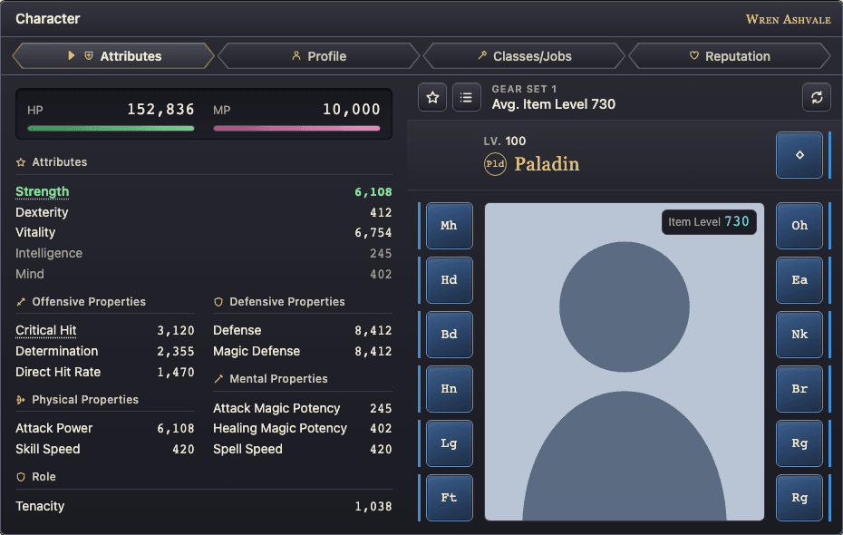
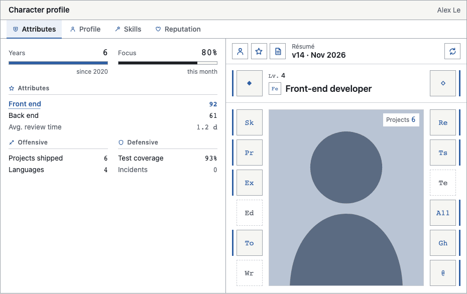

# Character panel (`@solution-nine/wol-character-panel`)

> **This README describes 2.0**, on npm's `next` tag until 2.0.0 is
> released: install `@solution-nine/wol-character-panel@next`, and try
> it in the [`/next/` demo](https://alexle08.github.io/wol-character-panel/next/). A bare
> install still gets 1.0.4, whose component is `CharacterSheet` (no
> `EquipmentPanel` or `CharacterWindow`); its README is at the
> [`v1.0.4` tag](https://github.com/AlexLe08/wol-character-panel/tree/v1.0.4#readme).

| `game` theme | `document` theme |
| --- | --- |
|  |  |
| The `adventurer` example | The `portfolio` example |

A React panel modelled on an RPG character/equipment screen, driven by one
JSON config. Use it for:

- **A portfolio**: skills, projects and contact details as gear, with a job
  for each role you want to show (the `portfolio` example).
- **A game character sheet**: a tabletop or fan character's gear, stats
  and jobs (the `adventurer` example).
- **A persona card**: a product persona or a team member, with what they
  carry and do.

Three words recur below:

- **Job**: one version of the character, with its own title, level,
  portrait and slot contents. The page shows one at a time (`?job=<id>`),
  and the job menu switches between them.
- **Slot**: one square in the layout, in a side column or beside the job
  title, with an item-card tooltip and a link.
- **Host**: your app, which renders the panel and provides React and zod.

```
title bar ............................ character name
[a] [b] [job menu]  caption                     [end]
[slot]  level / emblem + job title               [slot]
[col]   portrait (optional corner badge)          [col]
```

The two header slots sit either side of the job title (think main weapon and
job crystal), and the left and right columns hold up to 6 slots each. Above them, a
gear-set row holds icon links, the job menu and a caption. Each slot shows a
compact item-card tooltip on hover or keyboard focus. Clicking it goes to a page
section, another page, or an external site. Changing the job (`?job=<id>`) swaps the slots, tooltips, and
portrait, and the host page can swap its own content too.

`CharacterWindow` draws the whole character window around that panel: a tab
strip, and a content pane of the active tab's blocks (gauges, stats, fields)
beside the equipment pane.

Its only dependencies are React 19 and zod 4, which the host provides. It
ships as ES modules with type declarations (no CommonJS build), so it needs a
bundler or Node 22.12+.

```sh
npm install @solution-nine/wol-character-panel@next react zod
```

Try it at <https://alexle08.github.io/wol-character-panel/>: the playground
on the example configs, as of the latest release. The newest beta
is at <https://alexle08.github.io/wol-character-panel/next/> (the latest
release again when no beta is newer).

Accessibility, as the browser tests check it (Playwright, Chromium only):

- **No JavaScript needed:** tooltips, the job menu, tabs and detail
  windows work in the server-rendered panel with scripts off.
- **Keyboard:** Tab reaches every link and button, each with a visible
  focus ring; a tooltip shows on focus, and Escape hides it or closes the
  job menu.
- **axe:** no WCAG 2.2 A or AA violations in any example, in both themes,
  wide and narrow. Automated checks cover only part of WCAG.

Firefox, WebKit and screen readers aren't tested yet.

It recalls a well-known game's character screen without copying it (the
config decides which parts exist), and isn't affiliated with or endorsed
by that game's publisher.

## Entries

| Import | What it holds |
| --- | --- |
| `@solution-nine/wol-character-panel` | `parseConfig`, `loadConfig`, `findUnknownKeys`, `publicConfig`, `resolveJob`, `jobHref`, `resolveTab`, `tabHref`, `actionHref`, `withQuery` (sets or removes query parameters on an href, keeping the rest; `jobHref`, `tabHref` and `actionHref` are built on it), the config types, and the limits as plain values: `LIMITS` (max lengths and counts, grouped like the config), `ID_PATTERN` and `PARAM_NAME_PATTERN`. No React or CSS, so server code and plain Node can use it |
| `@solution-nine/wol-character-panel/react` | `EquipmentPanel`, `EquipmentPanelProps`, `EquipmentPanelParts`, `CharacterWindow`, `CharacterWindowProps`, `CharacterWindowParts`, `LinkRendererProps`. The components import their own CSS |
| `@solution-nine/wol-character-panel/schema` | `characterPanelConfigSchema`, the whole config's zod schema. Its parts are internal |
| `@solution-nine/wol-character-panel/character-panel.css` | The styles, for hosts that want to control CSS order |
| `@solution-nine/wol-character-panel/character-panel.schema.json` | The JSON Schema other backends validate against |

`react` and `zod` are peer dependencies: the host provides them.

## Config

A config is plain JSON. This one is small: one slot and one job.

```json
{
  "defaultJobId": "developer",
  "slots": [{ "id": "skills", "label": "Skills", "position": "left", "icon": "Sk" }],
  "jobs": [
    {
      "id": "developer",
      "name": "Developer",
      "title": "Developer",
      "level": { "label": "Lv.", "value": "1" },
      "slots": {
        "skills": {
          "tooltip": { "title": "Skills", "items": [{ "label": "Front end", "value": "React, TypeScript" }] },
          "action": { "kind": "anchor", "target": "skills" }
        }
      }
    }
  ]
}
```

- **Slots** are the layout: `left` and `right` columns of up to 6, and one
  `header-start` and one `header-end` beside the job title.
- **Jobs** fill the slots with a tooltip and an action (a same-page
  anchor, a site path, an external URL, a query parameter, or none), and
  set the title, level, portrait and badge. `?job=<id>` picks one.
- **Optional:** `characterName`, a `gearSet` row (icon links, the job menu
  and a caption) and `tabs` of blocks for `CharacterWindow`.

Add `"$schema"` pointing at `character-panel.schema.json` for autocomplete
and validation in your editor, either your installed copy or the published
one:

```json
"$schema": "https://cdn.jsdelivr.net/npm/@solution-nine/wol-character-panel@2/character-panel.schema.json"
```

That URL (the schema's `$id`) resolves once 2.0.0 is released; until
then, put `@next` in place of `@2`. The JSON Schema rejects unknown keys, while
`parseConfig` strips them (`findUnknownKeys` lists them). Jobs can be
`draft` or `hidden`: pass the config through `publicConfig()` before
rendering it for visitors.

The [config reference](https://github.com/AlexLe08/wol-character-panel/blob/main/docs/config.md)
lists every field, its limits and what `parseConfig` does with a bad one.
The repository's
[`examples/`](https://github.com/AlexLe08/wol-character-panel/tree/main/examples)
are complete configs: `adventurer` (a game character screen), `portfolio`
(a résumé), `minimal` and `edge-cases` (every field at its limit).

## Usage

```tsx
import { parseConfig, resolveJob } from "@solution-nine/wol-character-panel";
import { EquipmentPanel } from "@solution-nine/wol-character-panel/react";

const { config, errors } = parseConfig(json);   // or: const { config } = await loadConfig(sources, fallback)
const job = resolveJob(config, searchParams.job);

<EquipmentPanel
  config={config}
  job={job}
  theme="document"          // or "game"
  labels="narrow"           // slot names under squares: "narrow" (default) or "always"
  parts={{ toolbar: true }} // optional: which parts are drawn (below)
  gearSetEnd={<SaveButton />} // optional: your own control at the gear-set row's right end
  basePath="/"              // where the job links point
  renderLink={(p) => …}     // optional: your router's link (default <a>); p.intent says what it does:
                            // "job" (switch job), "tab" (switch tab or page, the window only),
                            // "param" (set a query parameter), "page" (another page of the site)
  renderPortrait={(p) => …} // optional: your image component (default )
  isParamActive={(name, value) => …} // optional: true for the param value the page applies
/>
```

The window takes every `EquipmentPanel` prop, plus the tab and page from the
URL:

```tsx
import { CharacterWindow } from "@solution-nine/wol-character-panel/react";

<CharacterWindow
  config={config}
  job={job}
  tab={searchParams.tab}    // the raw ?tab= value; unknown or missing: the first visible tab
  page={searchParams.page}  // the raw ?page= value, for a tab with pages
  tabParam="tab"            // optional: the parameters' names, as jobParam
  pageParam="page"
  hiddenTabs={["notes"]}    // optional: tab ids to leave out here
  parts={{ equipment: false }} // optional: also tabs and equipment (below)
  // …and theme, labels, basePath, jobParam, gearSetEnd, label,
  // renderLink, renderPortrait, isParamActive, as above
/>
```

Both are Server Components, with two small client files inside for
Escape and focus handling; they render in a plain client-side React app
too.

### In Next.js (App Router)

A complete page, with the config beside it as `app/character-panel.json`:

```tsx
// app/page.tsx
import Link from "next/link";
import { parseConfig, publicConfig, resolveJob } from "@solution-nine/wol-character-panel";
import { EquipmentPanel, type LinkRendererProps } from "@solution-nine/wol-character-panel/react";
// The components import their own CSS; import it yourself (here or in
// app/layout.tsx) only to place it before your own styles.
import "@solution-nine/wol-character-panel/character-panel.css";
import json from "./character-panel.json";

const parsed = parseConfig(json);
if (!parsed.config) throw new Error(parsed.errors.join("\n"));
const config = publicConfig(parsed.config); // leaves out drafts and anything hidden

// Switching jobs keeps the scroll position; other links scroll as usual.
function PanelLink({ intent, ...props }: LinkRendererProps) {
  return <Link {...props} scroll={intent !== "job"} />;
}

export default async function Page({
  searchParams,
}: {
  searchParams: Promise<{ [key: string]: string | string[] | undefined }>;
}) {
  const { job } = await searchParams; // a Promise since Next.js 15
  return (
    <main>
      <EquipmentPanel config={config} job={resolveJob(config, job)} renderLink={PanelLink} />
    </main>
  );
}
```

`CharacterWindow` goes in the same way, with `tab` and `page` from the
same `searchParams`. To send the portrait through `next/image`, pass
`renderPortrait`.

`loadConfig(sources, fallback)` tries each `{ name, load }` source in order,
such as an admin API, a CMS adapter, or a remote JSON file. It uses the first
one that yields a usable config. A source whose `load` resolves to `undefined`
has nothing yet (no save, an empty CMS entry) and is skipped without an issue;
a `load` that throws (unreachable, an HTTP error) is an issue. It never throws.
It resolves to `{ config, source, issues }`: `source` is the name of the source
used, or `null` when no source had a usable config and `config` is
`fallback`. `source === null` with issues means the page shows the fallback
because something failed, which a host can tell visitors about.

`parts` says which parts are drawn, `true` to draw one: `bar`,
`characterName`, `gearSet` and `jobMenu` default to `true`; `toolbar` (round
buttons under the portrait) and `sockets` (two dots on each filled slot)
default to `false`. `gearSet: false` removes the whole row, with the job menu
and `gearSetEnd`; `jobMenu: false` removes only that button. In
`CharacterWindow`, `tabs` (the strip and the content pane) and `equipment`
(the equipment pane) default to `true` as well. The toolbar and
sockets are visual only for now. They're hidden from assistive tech and
aren't focusable. When either one gets a real function, make it a real
control (`<button>`, with a label) instead.

A `gearSetEnd` control takes the row's square button look from the
`cs__gear-button` class; name it with visually hidden text (`cs-visually-hidden`)
or an `aria-label`.

## Behaviour

Tooltips show on hover and keyboard focus through CSS, and the job menu
and detail windows are popovers of links and buttons, so the panel works
before hydration and without JavaScript (with it, Escape also dismisses a
tooltip, and the job menu closes when focus leaves it). Tabs,
jobs and pages are links (`?tab=`, `?job=`, `?page=`), so every view has a
URL and the back button works. The layout is a container query: it
follows the panel's width, not the viewport's, and below 26rem the
portrait moves on top and slot names show. [Behaviour](https://github.com/AlexLe08/wol-character-panel/blob/main/docs/behaviour.md)
covers each part in full.

## Theming

Override any `--cs-*` variable on `.cs`, or add a theme block like
`.cs[data-cs-theme="game"]`. The `document` theme reads the host's
`--paper`/`--ink`/`--signal`/… tokens when they exist and falls back to neutral
colours otherwise.

The portrait's badge sits on a plate, `--cs-badge-bg` (the panel's colour by
default), so its text keeps its contrast over any portrait; keep it opaque.

The window adds `--cs-tab-bg` and `--cs-tab-active-bg` (tabs),
`--cs-bar-track` and `--cs-bar-fill` (bars), `--cs-gauge-primary` and
`--cs-gauge-secondary` (a gauge's two tones), `--cs-stat-highlight` (a
`highlight` stat) and `--cs-level-highlight` (a `highlight` level). In the
`document` theme they come from the existing colours; the `game` theme gives
them gradients and its own tones.

## Versioning

Semver, keyed to the config contract: a new optional field, a looser
limit or a new export is a minor or patch release; a new required field,
a tighter limit, a removed key or export, or a change in behaviour hosts
rely on is a major one, and moves the schema's `$id` to the new major. [CHANGELOG.md](https://github.com/AlexLe08/wol-character-panel/blob/main/CHANGELOG.md)
lists what each release changed for hosts.

## More

- [Config reference](https://github.com/AlexLe08/wol-character-panel/blob/main/docs/config.md):
  every field, its limits and how bad ones are reported.
- [Behaviour](https://github.com/AlexLe08/wol-character-panel/blob/main/docs/behaviour.md):
  tooltips, menus, tabs, rows, detail windows and the layouts.
- [Contributing](https://github.com/AlexLe08/wol-character-panel/blob/main/CONTRIBUTING.md)
  (with the development and releasing notes)
  and [security](https://github.com/AlexLe08/wol-character-panel/blob/main/SECURITY.md).

It started in, and runs the home page of,
[the-portfolio-site](https://github.com/AlexLe08/the-portfolio-site).

MIT licensed.
